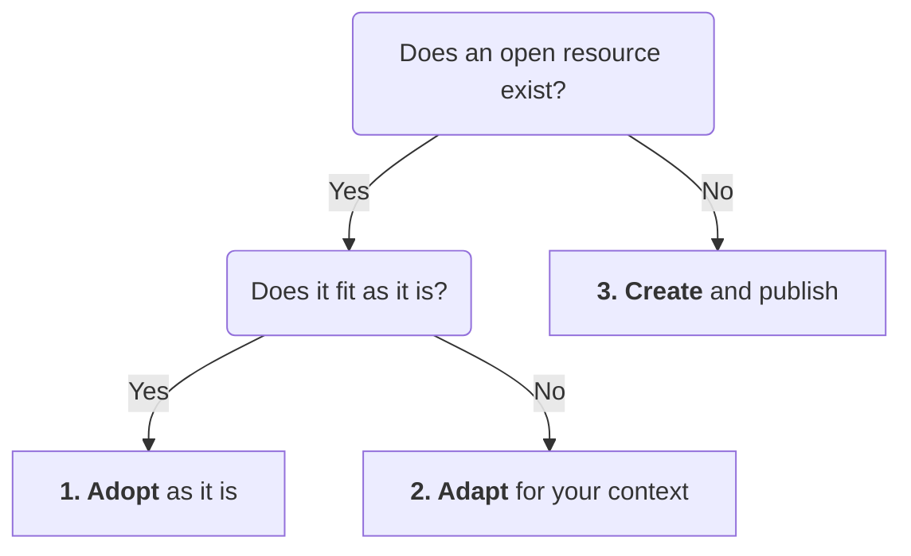
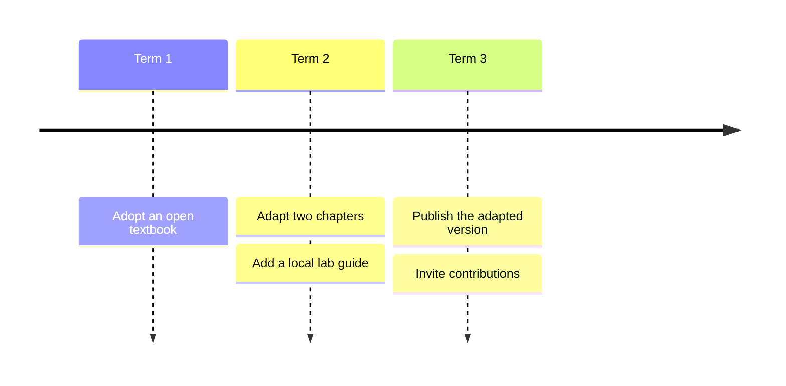
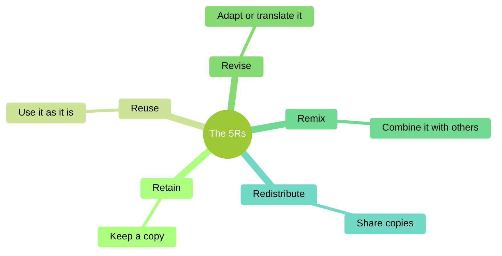
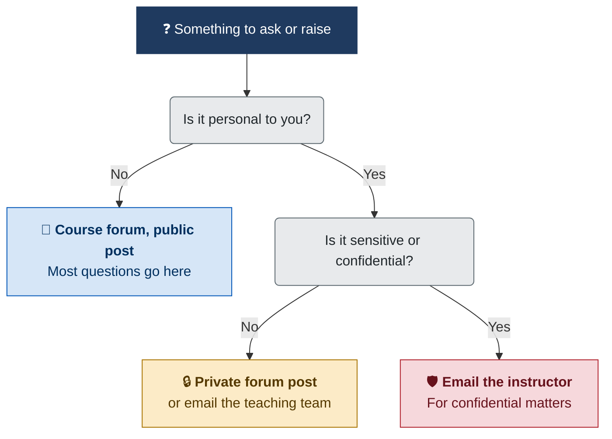
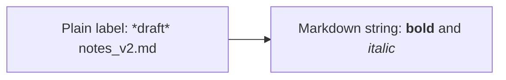

The Mermaid plugin turns text in a page into diagrams – flowcharts, sequence diagrams, timelines, mind maps and more. Diagrams match the site's light or dark mode, so try the light/dark switch, and they always print in light colours.

This page is also a test page: copy it into a site's `user/pages` (for example as `99.mermaid-demo/default.md`) and check it against the list at the end.

## A Flowchart

Choosing how to start with open educational resources (OER) comes down to two questions:



The diagram is written as text, in a code block marked `mermaid`, so anyone reusing the page can revise it:

~~~markdown

~~~

The `accTitle` and `accDescr` lines give screen readers a title and description, like an image's alt text.

## A Sequence Diagram

How a page edit travels between Grav and a Git repository with Git Sync. This one uses the older `[mermaid]...[/mermaid]` tags from the Mermaid Diagrams plugin, which still work.

[mermaid]
sequenceDiagram
    accTitle: How Git Sync keeps a site and its repository in step
    accDescr: An author saves a page in Admin, and Grav commits and pushes it to GitHub. A contributor proposes a change on GitHub; once it is merged, a webhook tells Grav, which pulls the update.
    actor Author
    participant Grav
    participant GitHub
    actor Contributor
    Author->>Grav: Save a page in Admin
    Grav->>GitHub: Commit and push
    Contributor->>GitHub: Propose a change
    GitHub->>Grav: Webhook, once merged
    Grav->>GitHub: Pull the update
[/mermaid]

## A Timeline

One way a course might move to open materials, a step at a time:



## A Mind Map with Its Own Colours

The 5Rs of open content. This diagram sets its own colour theme (`forest`), which it keeps in both light and dark mode.



## Custom Colours

Boxes can have their own colours with `classDef`. Here, white text on a dark box, and bold text from Markdown strings:



## Text as Typed

In plain labels, characters such as `*` and `_` show exactly as typed – Grav's Markdown never changes diagram text. For bold or italics, use a Markdown string in backticks instead.



## A Diagram with a Mistake

A diagram that Mermaid can't read shows an error box in its place, and the rest of the page still works:

```mermaid
flowchart LR
    A -->
```

## Testing Checklist

When checking this page after an update, each item should hold:

- Every diagram above draws, except the one with a mistake, which shows an error box
- No diagram code shows while the page loads – just a blank space until each diagram appears
- Switching light and dark mode redraws the diagrams to match, except the mind map, which keeps its `forest` colours
- Printing from dark mode gives light diagrams
- The dark box in Custom Colours has white text
- In Text as Typed, `*draft*` and `notes_v2.md` show as typed, while the Markdown string shows bold and italics
- The two code blocks below, and the one in A Flowchart, stay as code

A plain code block:

```
flowchart LR
    A --> B
```

A `[mermaid]` tag inside a code block:

~~~markdown
[mermaid]
flowchart LR
    A --> B
[/mermaid]
~~~
