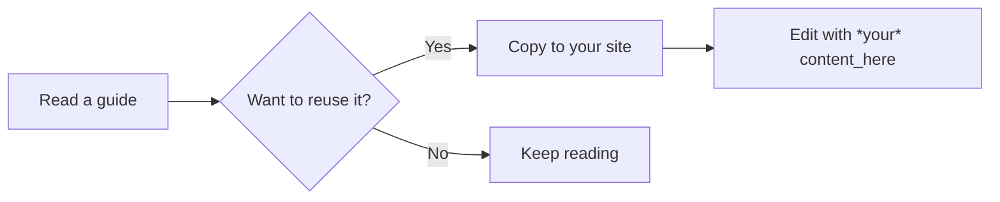
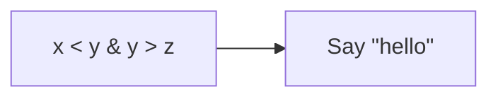
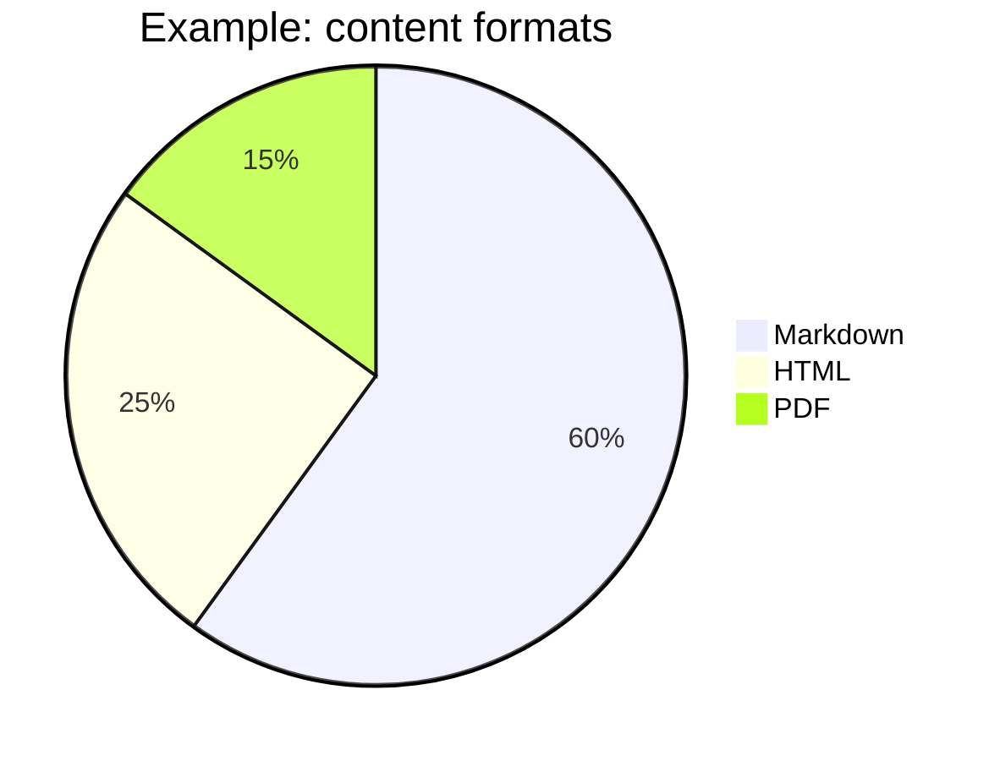
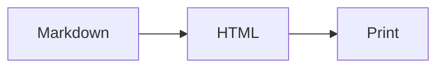
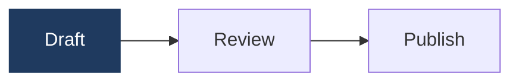
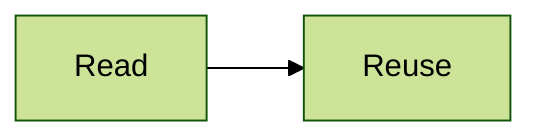
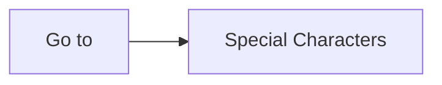
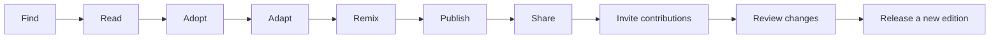
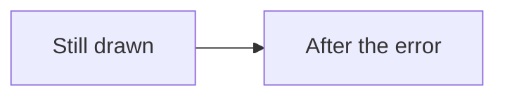
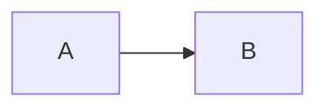

Edge cases for the Mermaid plugin, each with what to expect. Copy this page into a site's `user/pages` (for example as `99.mermaid-test/default.md`), and check it in light and dark mode, and printed from dark mode. For the main features, see `mermaid-demo.md`.

## Fenced Block with Markdown Characters

Expect: the labels read exactly as typed, including `*your*` and `content_here` – Grav's Markdown doesn't change diagram text.



## Older [mermaid] Tags

Expect: a sequence diagram. The mention of [mermaid] in this heading and sentence is left alone – only a tag at the start of a line counts.

[mermaid]
sequenceDiagram
    Author->>Grav: Save page
    Grav-->>Reader: Show diagram
[/mermaid]

## Special Characters

Expect: `<`, `>`, `&` and quotes show as typed.



## Several Diagrams in a Row

Expect: both draw, one after the other.





## Multi-line Description and Custom Colours

Expect: a screen reader announces the title and the full description; the dark box has white text, in light and dark mode.



## Own Colour Theme

Expect: green (`forest`) in both light and dark mode.



## A Link in a Diagram

Expect: clicking Special Characters jumps to that section of this page.



## A Wide Diagram

Expect: with Diagram Width set to Fit to Page, it shrinks to fit; with Natural Size, it scrolls sideways without the page scrolling.



## In a Closed Details Box

Expect: open the box to find a correctly drawn diagram, with labels that fit their boxes. (Written as HTML, as Markdown inside HTML needs Markdown Extra.)

<details>
<summary>Show the diagram</summary>
<pre><code class="language-mermaid">flowchart LR
    A[Hidden at first] --&gt; B[Still drawn correctly]
</code></pre>
</details>

## A Diagram with a Mistake

Expect: an error box, while the diagrams after it still draw.

```mermaid
flowchart LR
    A -->
```



## Not Drawn

Expect: all three stay as code.

A plain code block:

```
flowchart LR
    A --> B
```

A `[mermaid]` tag inside a code block:

```text
[mermaid]
flowchart LR
    A --> B
[/mermaid]
```

A Mermaid example shown as source, wrapped in `~~~` rather than four backticks, which Grav's Markdown ends at the first inner fence:

~~~markdown

~~~
